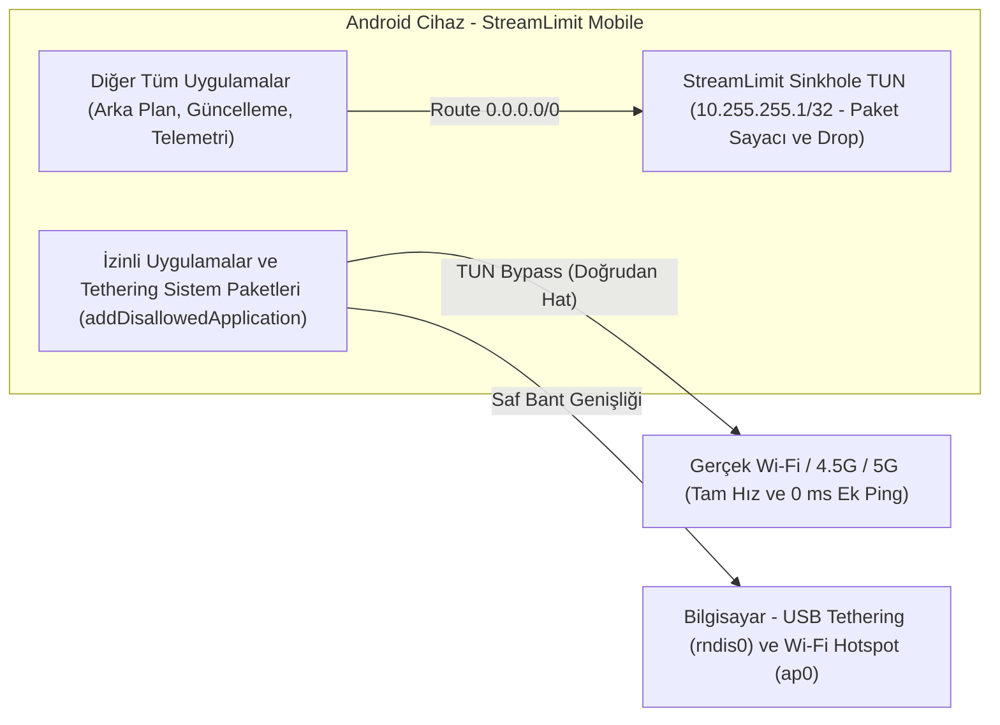

# 🛡️ StreamLimit Mobile

<p align="center">
  <b>Root Gerektirmeyen Uygulama Bazlı Ağ İzolasyon (Whitelist) & %100 PC Tethering / Hotspot Bant Genişliği Kalkanı</b>
</p>

<p align="center">
  <a href="https://github.com/Jung1330/StreamLimitMobile/releases/latest">
    
  </a>
  
  
  
</p>

---

**StreamLimit Mobile**, masaüstü **StreamLimitPC** uygulamasının Android versiyonudur. Seçtiğiniz izinli uygulama(lar) (**Whitelist**) dışındaki tüm uygulamaların internet erişimini **root gerektirmeden** çekirdek düzeyinde tamamen keser.

Ayrıca özel **"💻 Sadece PC'ye İnternet Ver (USB Tethering & Wi-Fi Hotspot İzolasyon Modu)"** sayesinde telefonunuzu bilgisayara USB Tethering veya Wi-Fi Hotspot ile bağladığınızda telefondaki tüm arka plan uygulamalarının internetini sıfırlar ve mobil verinizin **%100'ünün** gecikmesiz olarak bilgisayara akmasını sağlar.

---

## 📥 İndirme ve Kurulum (APK)

En güncel kurulabilir `.apk` dosyasını doğrudan **[GitHub Releases (v1.0.0)](https://github.com/Jung1330/StreamLimitMobile/releases/latest)** sayfasından indirebilirsiniz:

- 📦 **[StreamLimitMobile.apk İndir (v1.0.0 Release)](https://github.com/Jung1330/StreamLimitMobile/releases/download/v1.0.0/StreamLimitMobile.apk)**

---

## ✨ Temel Özellikler

### 1. ⚡ Root Gerektirmeyen `VpnService` Sinkhole + Doğrudan Bypass Mimarisi
- **Sanal TUN Kara Deliği (Sinkhole):** İzinsiz tüm uygulamaların trafiğini `10.255.255.1/32` (IPv4) ve `fd00:dec0:de00::1/128` (IPv6) sanal TUN arayüzüne yönlendirerek çekirdek düzeyinde düşürür (`0 byte` dış ağ erişimi).
- **%100 Doğrudan Hat Hızı & 0 ms Ek Gecikme (`addDisallowedApplication`):** Klasik güvenlik duvarı/VPN uygulamalarının aksine, izin verilen (Whitelist) uygulamaların paketlerini VPN tünelinden **geçirmez**. İzinli uygulamalar sanal TUN arayüzünü tamamen bypass ederek telefonun gerçek Wi-Fi / 4.5G / 5G donanım arayüzünü doğrudan kullanır:
  - **0 ms** ek ping / gecikme
  - **%100** kayıpsız indirme ve yükleme hızı
  - **Sıfır** ekstra CPU ve pil tüketimi
- **Canlı Kara Delik Paket Denetçisi:** Sanal TUN arayüzüne düşen engellenmiş paketlerin IPv4/IPv6, TCP ve UDP başlıklarını gerçek zamanlı ayrıştırarak kaç paketin ve kaç MB verinin engellendiğini canlı gösterir.

### 2. 💻 Özel Mod: "Sadece PC'ye İnternet Ver (USB Tethering & Wi-Fi Hotspot Modu)"
- Kontrol panelinden tek dokunuşla açılabilen bu mod aktif edildiğinde telefondaki **hiçbir kullanıcı uygulamasına izin verilmez (`0` uygulama)**.
- Yalnızca cihazdaki Android Tethering / Hotspot sistem paketleri (`com.android.networkstack.tethering`, `com.google.android.networkstack.tethering`, `com.android.tethering`, `com.samsung.android.networkstack.tethering`, `com.android.networkstack` vb.) otomatik tespit edilerek `addDisallowedApplication` ile korunur.
- Ağ arayüzlerini (`rndis0`, `usb0`, `ncm0` USB Tethering ve `ap0`, `wlan1`, `swlan0` Wi-Fi Hotspot) saniyede bir canlı denetler; bağlantı durumunu ve IP adresini panelde gösterir.

### 3. 🎯 Hazır ve Özelleştirilebilir İzolasyon Profilleri
- **💻 Sadece PC (Tethering):** Telefondaki tüm uygulamaları susturur, tüm bant genişliğini PC bağlantısına ayırır.
- **🎮 Oyun Modu:** Arka plan güncellemelerini, senkronizasyonları ve telemetriyi keser; sadece seçili mobil oyunlara ve sesli sohbete (Discord vb.) saf internet verir.
- **📡 Sosyal / Yayın Modu:** Yayın izlerken veya mesajlaşırken diğer uygulamaların bant genişliği tüketmesini engeller.
- **🛡️ Özel Profil & Yeni Profil Oluşturma:** Dilediğiniz kadar özel profil oluşturup tek dokunuşla profiller arasında geçiş yapabilirsiniz.

### 4. 📱 Gelişmiş Uygulama Seçici (Whitelist) & Canlı Telemetri
- Telefonda kurulu `android.permission.INTERNET` iznine sahip tüm uygulamaları gerçek ikonları, uygulama adı ve paket adıyla listeler.
- **Anlık Arama & Filtreleme:** *Kullanıcı Uygulamaları*, *Sistem Uygulamaları* ve *İzinliler* sekmeleriyle hızlı çoklu seçim.
- **Canlı Hız Ölçer (`TrafficStats`):** Anlık İndirme (DL) ve Yükleme (UL) hızlarını `Mbps` cinsinden saniyede bir günceller.
- **Kalıcı Foreground Service & Acil Durdurma Bildirimi:** Uygulama kapatılsa bile arka planda kesintisiz çalışır; bildirim üzerindeki **"İzolasyonu Durdur (Acil Aç)"** butonuyla tek dokunuşla tüm internet normale döndürülebilir.

---

## 🏗️ Teknik Mimari Özeti



---

## 🚀 Kurulum Seçenekleri

### 1. Telefon Üzerinden Doğrudan Kurulum
1. **[Releases](https://github.com/Jung1330/StreamLimitMobile/releases/latest)** sayfasından `StreamLimitMobile.apk` dosyasını indirin ve telefonunuza kurun.
2. Uygulamayı açıp izin vermek istediğiniz uygulamaları seçin (veya **Sadece PC'ye İnternet Ver** anahtarını açın) ve **İzolasyonu Başlat** butonuna dokunun.

### 2. ADB ile Bilgisayardan Kurulum
```bash
adb install -r dist/StreamLimitMobile.apk
```

### 3. Kaynak Koddan Derleme
Proje **Android SDK 34**, **Gradle 8.12** ve **JDK 17/21** ile sıfır ek yapılandırma gerektirmeden derlenebilir:

```bash
# Windows
.\gradlew.bat assembleRelease

# Linux / macOS
./gradlew assembleRelease
```

Derlenen imzalı APK çıktısı `app/build/outputs/apk/release/app-release.apk` konumunda üretilir.

---

## 📂 Proje Dizin Yapısı

```text
StreamLimitMobile/
├── app/
│   ├── build.gradle.kts
│   ├── proguard-rules.pro
│   └── src/main/
│       ├── AndroidManifest.xml
│       ├── java/com/streamlimit/mobile/
│       │   ├── MainActivity.kt          # Koyu Obsidian (#0B0E14) UI & Canlı Telemetri Paneli
│       │   ├── StreamLimitVpnService.kt # Root'suz Sinkhole TUN & Disallowed Bypass Motoru
│       │   ├── TetheringDetector.kt     # USB (rndis0/usb0) & Hotspot (ap0/wlan1) Canlı Tespit
│       │   ├── AppPreferences.kt        # Profil, Whitelist ve Sistem Koruma Yönetimi
│       │   └── AppRepository.kt         # İnternet İzinli Kurulu Uygulama Tarayıcısı
│       └── res/
│           ├── drawable/                # Vektörel Uygulama Logosu & Bildirim İkonları
│           └── values/                  # Obsidian Renk Paleti, Tema ve Metin Kaynakları
├── dist/
│   └── StreamLimitMobile.apk            # Doğrudan Kurulabilir İmzalı Release APK
├── gradle/wrapper/
├── build.gradle.kts
├── settings.gradle.kts
└── README.md
```

---

## 📄 Lisans

Bu proje [MIT Lisansı](LICENSE) altında lisanslanmıştır.
